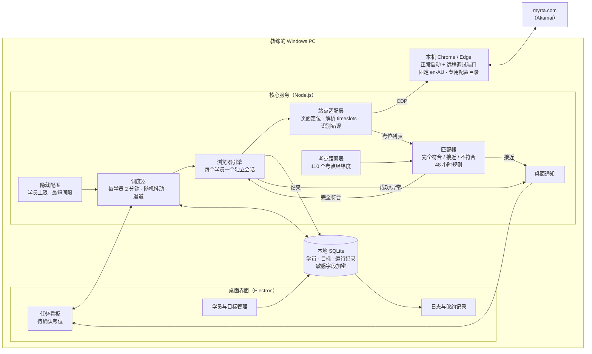
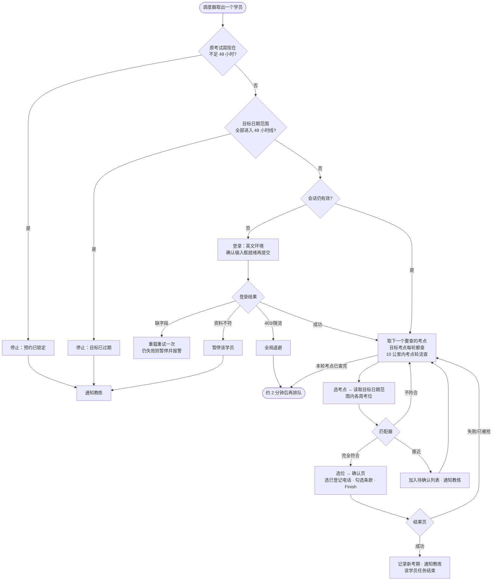
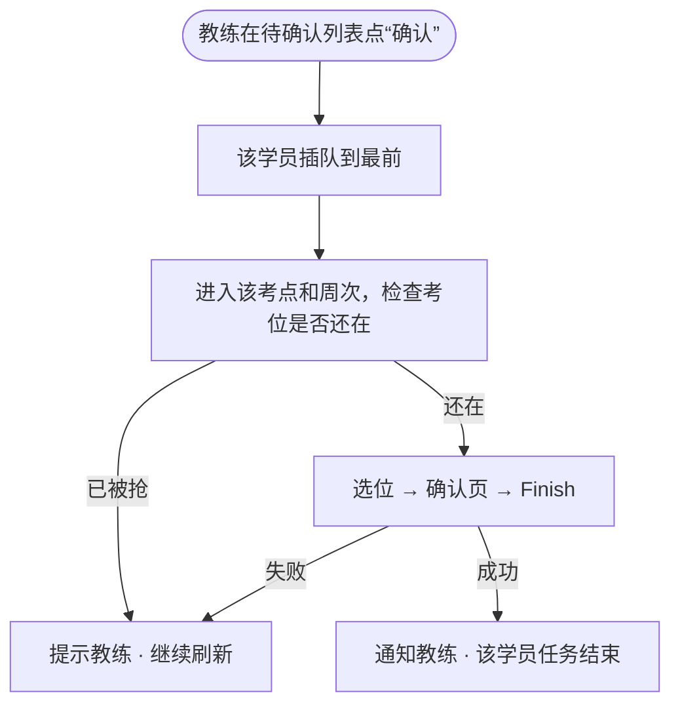
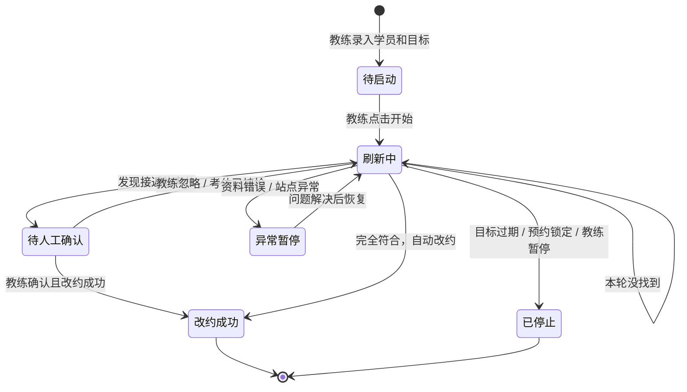

# myRTA 驾考改约工具：需求归纳与初步架构

状态：草案 v3，待确认问题已全部答复，待教练审阅
来源：README、2026-11-11 与教练的沟通记录、同日对 myrta.com 的两次实地探索

## 1. 背景与痛点

使用者是驾校教练，手上有很多学员，每个学员都有一个已有的驾考预约（Car: Driving Test）。

- 教练现在要逐个打开浏览器、登录、换考点、翻日期，学员多时非常费时。
- 别人取消或改掉的考位会重新放出来，但有很多人在用程序抢同样的时间。等人工确认时考位往往已经被抢走。
- 学员常有临时需求，例如"下周就想考"，当下没有考位，只能反复刷。

工具要做的是：教练为每个学员设定想要的考点和时间，工具持续刷新，出现完全符合的考位就自动换过去；出现接近的考位就提醒教练决定。

## 2. 需求清单

### 2.1 功能需求

| 编号 | 需求 |
|---|---|
| F1 | 管理学员：Booking number、姓氏、当前考点和考期 |
| F2 | 每个学员设定目标：考点（可多个）、日期范围、每天的时间段 |
| F3 | 持续刷新，没找到就一直找 |
| F4 | **完全符合**的考位：自动改约并提交，事后桌面通知教练 |
| F5 | **接近**的考位：桌面通知教练，教练在软件里确认后才改约 |
| F6 | 改约成功后，这个学员的任务结束，不再继续找。不满意由教练重新发起 |
| F7 | 先做 Windows PC 端，架构保持跨平台，以后可出 Mac 版；移动端暂不做 |
| F8 | 通知方式：只做桌面通知 |

### 2.2 匹配规则

| 结果 | 条件 | 动作 |
|---|---|---|
| 完全符合 | 考点在目标列表里，日期在目标范围内，时间在目标时间段内 | 自动改约 |
| 接近 | 日期在目标范围内；考点在目标列表里**或**距离任一目标考点不超过 10 公里；时间在目标时间段内**或**偏差不超过 1 小时；且不是完全符合。考点和时间同时有偏差也算接近 | 通知教练确认 |
| 不符合 | 其他情况，包括日期超出目标范围 | 忽略 |

- 距离按直线距离计算，用站点提供的考点经纬度。新南威尔士全州 110 个考点的坐标已经抓取到 `docs/data/nsw-test-centres.json`。
- 以 Silverwater 为例，10 公里内有 Auburn（2.2 km）、Mobile Service Centre 6（3.1 km）、Merrylands（5.6 km）、North Rocks（6.9 km）、Ryde（8.1 km）、Bankstown（9.7 km）。
- 匹配参数做成可调配置，默认值如下：

| 参数 | 默认值 | 说明 |
|---|---|---|
| 时间偏差上限 | 60 分钟 | 超出目标时间段多少分钟以内算接近 |
| 距离上限 | 10 公里 | 距离目标考点多少公里以内算接近 |
| 日期偏差上限 | 0 天 | 默认不允许日期偏差。参数保留，以后需要时可以放开 |

### 2.3 业务规则（官方限制）

| 编号 | 规则 | 来源 |
|---|---|---|
| R1 | 不能改到距现在不足 48 小时的考位。例如 11 日最早只能约 13 日 | 教练；页面写明"At least 2 days before the scheduled Driving Test" |
| R2 | 原考试距现在不足 48 小时，预约被锁定，不能再改 | 教练 |
| R3 | 目标日期范围内能约的时间全部进入 48 小时线后，停止刷新 | 双方商定 |

### 2.4 刷新频率与隐藏配置

- 默认每个学员每 **2 分钟**检查一轮，实际间隔在 ±20% 内随机，避免固定节奏。
- 首版同时运行的学员上限为 **2 个**。
- 学员上限和最短间隔放在隐藏配置里，界面上不显示，以后作为收费功能开放。
- 对 2 分钟间隔的评估见第 6 节。

### 2.5 非功能需求

- **速度**：完全符合的考位从发现到提交，尽量控制在 30 秒内。
- **稳定**：长时间无人值守运行。遇到不认识的页面就停下报警，不乱点。
- **安全**：学员预约信息只存在本机，敏感字段加密。
- **测试约定**：真实改约测试前先告诉教练，由教练通知学员；不能改进 48 小时以内。

## 3. 已探明的站点行为

### 3.1 改约流程（2026-11-11 用学员 Du 走到第 4 步，未提交）

| 步骤 | 页面与操作 | 实测耗时 |
|---|---|---|
| 登录 | 首页 → Manage booking → 输入 Booking number 和姓氏 → Continue | 约 20 秒 |
| 1 查看预约 | 显示当前考点、日期、时间，有 Change location、Change date/time、Cancel booking 三个入口 | — |
| 2 选考点 | 按郊区搜索，或从 110 个考点的下拉框选择 → Next（`action!ChooseLocation`） | — |
| 3 选时间 | 每页显示一周，考位数据内嵌在页面的 `timeslots` JSON 里。可以翻周（`action!nextWeek`），也可以跳到最早有空位的一周（`action!getEarliestTime`）。点可用考位后点 Next（`action!chooseTime`） | 选考点到出考位约 15 秒；翻一周约 13 秒 |
| 4 确认 | 显示新考点和时间，选择联系电话（可用已登记号码），勾选条款，点 Finish（`action!Confirm`） | 进入约 11 秒 |
| 完成 | **未探索**。按约定没有点 Finish | — |

实测耗时（2026-11-11 晚，站点较慢时）：首次登录 70–95 秒；选考点读第一周约 25 秒；每多翻一周约 25 秒；选位到确认页约 10 秒；放弃并回到查看预约页约 35 秒。

验证结果：在第 4 步放弃后，我用新会话重新登录查看，Du 的预约仍是 2026-12-30 11:30 Silverwater，没有被改动。

### 3.2 访问与反自动化

| 项目 | 结论 |
|---|---|
| 浏览器启动方式 | 用 Playwright 直接启动的浏览器（`navigator.webdriver = true`）被 Akamai 返回 403。正常启动的 Chrome 再通过远程调试端口连接（`webdriver = false`），同一网络下访问正常 |
| IP | 之前怀疑机房 IP 被封，这个判断有误。同一出口 IP 下，正常浏览器可以访问，被拦的是自动化特征 |
| 浏览器语言 | 中文环境下登录控件不初始化，提交时缺字段，报 "Enter all mandatory fields"。必须固定英文（`en-AU`） |
| 验证码 | 登录和改约流程中都没有出现 |
| 页面跳转 | IBM WebSphere Portal，URL 带会话令牌，只能沿页面逐步操作 |
| 请求量 | 本次完整走一遍共 31 次页面加载；加上静态资源和 Akamai 遥测，共 1102 个请求，没有出现 4xx/5xx |
| 会话超时 | 页面有 "Session timeout" 提示，具体时长未知 |

## 4. 系统架构

图片版：`docs/diagrams/1-architecture.png`、`2-check-flow.png`、`2b-confirm-flow.png`、`3-task-states.png`（另有同名 SVG）。

### 模块职责

| 模块 | 做什么 | 不做什么 |
|---|---|---|
| 桌面界面 | 录入学员和目标；显示状态和日志；列出待确认考位，让教练确认或忽略 | 不直接访问站点 |
| 调度器 | 按间隔排队检查学员，控制全局访问节奏，被限流时退避；执行学员上限 | 不解析页面 |
| 浏览器引擎 | 以正常方式启动本机 Chrome/Edge，再通过 CDP 控制；每个学员一个独立会话，尽量复用登录状态 | 不判断考位好坏 |
| 站点适配层 | 所有页面元素定位、数据解析、错误识别集中在这里。站点改版时只改这一层 | 不做业务决策 |
| 匹配器 | 纯函数：输入目标、考点距离表、考位列表和当前时间，输出完全符合 / 接近 / 不符合 | 不访问网络，方便单独测试 |
| 考点距离表 | 内置 110 个考点的坐标，定期从站点更新 | — |
| 通知 | 改约成功、发现接近考位、出现异常时弹桌面通知 | — |

## 5. 流程

### 5.1 单个学员的一轮检查

### 5.2 教练确认接近的考位

### 5.3 学员任务状态

待人工确认期间，工具继续刷新。如果在教练确认之前出现完全符合的考位，照常自动改约。

## 6. 2 分钟间隔的评估

**结论：2 分钟适合作为 2 个学员的默认值。** 它不能保证不被封，也不能保证抢得过别人。

- **访问量。** 2 个学员各 2 分钟一轮，每轮在会话复用的情况下约 2 到 6 次页面加载。平均每分钟 2 到 6 次，接近一个人手动操作的节奏。本次探索在约 25 分钟里走了 31 次页面加载，没有被拦。Akamai 的限流阈值不公开，安全上限只能在实际运行中观察。
- **能不能抢到。** 考位放出到被发现，平均等 1 分钟，最长 2 分钟。别人刷得更快时，有一部分考位会被抢先。真正拉开差距的是发现之后的速度：完全符合时直接提交，实测从选位到确认页约 11 秒，不需要等人。
- **每轮检查本身的耗时。** 选考点到出考位约 15 秒，每多翻一周约 13 秒。一个学员如果有 1 个目标考点、查 3 周，一轮约 40 秒。如果 10 公里内的 6 个考点每轮都查，一轮会超过 3 分钟，2 分钟间隔就失去了意义。所以目标考点每轮都查，附近考点每轮轮流查一个。
- **退避。** 出现 403、异常页面或明显变慢时，全局暂停并逐步拉长间隔，恢复正常后再回到 2 分钟。

## 7. 主要风险

| 风险 | 影响 | 应对 |
|---|---|---|
| 被 Akamai 识别为自动化 | 所有学员同时停摆 | 用正常启动的浏览器加 CDP 控制，不用自动化启动；固定节奏加随机抖动；出现异常立即退避 |
| 和其他抢位程序竞争 | 看到了也抢不到 | 完全符合时直接提交；复用登录会话，省掉重复登录的 20 秒 |
| 结果页没探索 | 可能误判改约是否成功 | 第一次真实改约由教练在场；之后每次改约都重新查询预约详情来核实 |
| 站点改版 | 脚本失效 | 页面适配集中在一层；遇到不认识的页面就停下报警 |
| 使用条款与授权 | 合规风险 | 确认页的条款要求遵守站点使用规则，我没有逐条审阅关于自动化访问的条款。建议上线前查清楚；取得学员同意，数据只存在本机 |

## 8. 已确认的决定

| 问题 | 决定 |
|---|---|
| 考点和时间同时有偏差 | 算接近，需教练确认 |
| 距离计算方式 | 直线距离 |
| 日期偏差 | 默认不允许，保留参数以后调整 |
| 第一次真实改约 | 所有流程开发完成后，由教练通知再进行 |

## 9. 第一次真实改约之前的处理

完成页和会话超时时长要等第一次真实改约才能摸清。在那之前：

- 开发和测试只走到确认页，不点 Finish。
- 自动改约功能默认关闭，提交前停在确认页并提示"待验证"。第一次真实改约成功、完成页识别规则补齐后再打开。
- 每次改约后都重新查询预约详情，用新的考点和时间核实结果，不只依赖完成页的文字。
